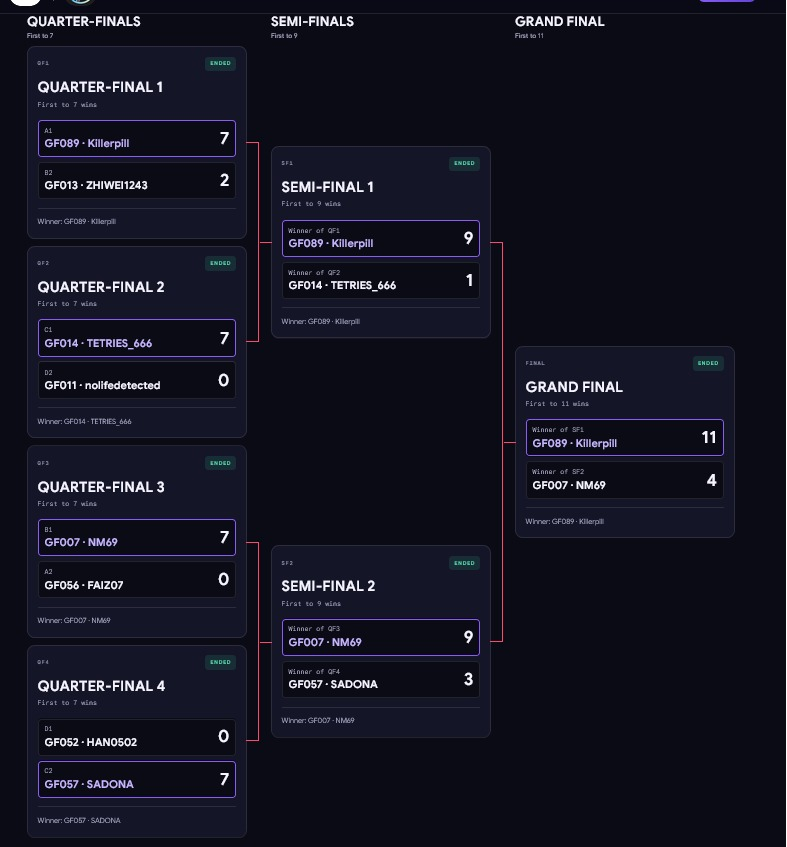
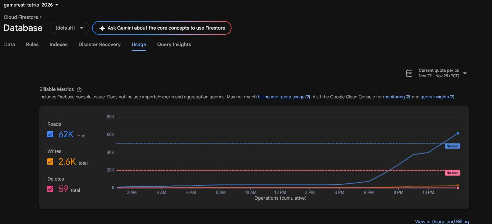

# GameFest TETR.IO Showdown

Tournament management, audience predictions and an administrator-operated Lucky Draw for GameFest TETR.IO Showdown 2026. The event concluded on **28 November 2026**. The project is complete for the 2026 event and available for future maintenance and reuse; not every proposed improvement was implemented.

**Website:** https://gamefest-tetrio-2026.web.app/

**Repository:** https://github.com/GDGoC-USM/gamefest-tetrio-2026

**Architecture visualisation:** https://gitdiagram.com/gdgoc-usm/gamefest-tetrio-2026

## Start here: handover to future batches

Read **[For thou in the future](For%20thou%20in%20the%20future.md)** before significant changes. This original, human-written account covers development history, D-Day experiences, technical challenges, known bugs, mobile/desktop UI/UX suggestions, security and infrastructure concerns, and advice for future Technical Department members. Its informal wording and personal closing are preserved unchanged.

Treat its incidents and suggestions as historical observations, not verified root causes or permission to repeat production workarounds. In particular, never derive public names from email addresses. Understand the architecture and verify behavior against source and tests before changing it.

## Technology and current functionality

Static HTML, CSS and browser JavaScript ES modules; Firebase Authentication, Cloud Firestore and Firebase Hosting; Firebase JavaScript SDK **11.10.0** from Google's CDN. There is no framework, application server, Cloud Function, scheduled scorer, package manifest or build step. Browser SDK loading needs network access on first load.

Participants can:

- Follow rooms, the knockout bracket and published results on Home and Matches.
- Use shared Google sign-in/sign-out controls on Home, Matches, Predict and Leaderboard, with session-restoration/error states.
- Edit their public Full Name on Predict; save, change or reset private room predictions while permitted.
- View public rankings, UID-matched personal prediction statistics, their highlighted row and **Find my position**. Personal **Submitted Tickets** counts unique saved prediction rooms, not selected players or Lucky Draw tickets.
- Read the [participant FAQ](public/faq.html) for navigation, predictions, deadlines and troubleshooting. **Its draw-policy wording predates base tickets; use the policy below.**

Administrators can:

- Configure rosters manually or by validated competitor CSV import; manage statuses and stage/room prediction controls.
- Publish, correct and reopen results with dependency/stale-state checks and targeted feeder resets.
- Recalculate absolute leaderboard scores, reset public names to `Participant`, and preview/resume UID-scoped test-participant cleanup.
- Refresh/certify draw tickets; manage manual participants and bulk pasted names; remove/restore participants independently of winner exclusions.
- Run a weighted wheel with presentation mode, synchronized pointer/result geometry, winner celebration, persisted history and undo.

### Tournament and prediction rules

- Groups `A`–`D` have eight slots each; blanks are allowed, but readiness needs at least two distinct real players. Five cumulative group FFA rounds are the documented format; the application records only two manually published qualifiers in first/second order, not group-round scores. Roster order never determines seeds.
- Quarter-finals are two-player FT7: `QF1=A1/B2`, `QF2=C1/D2`, `QF3=B1/A2`, `QF4=D1/C2`. A1/A2 mean published qualifier order.
- `SF1` takes QF1/QF2 winners; `SF2` takes QF3/QF4 winners. Both are FT9. Their winners enter `FINAL` (FT11); losers enter `THIRD` (FT9).
- QF losers enter `PLACEMENT`: five ordered four-player FFA rounds, worth 4/3/2/1 competition points. Tied totals leave placings pending unless an organiser supplies a complete ranking consistent with unequal totals. Unresolved ties may be published. These are not audience prediction points.
- Groups accept two distinct qualifier picks, unordered for scoring; each series, including THIRD, accepts one winner. PLACEMENT has no predictions. Each correct selected player earns **one leaderboard point and one additional draw ticket**. No multipliers or podium bonuses; unresolved/unpublished picks remain pending.
- Saving/resetting requires sign-in, an open stage, ready/confirmed players, an unlocked room, unpublished results and status other than `completed`. FINAL/THIRD share the `final` stage. **Live does not lock predictions.** Only `predictionsLocked === true` locks a room; a missing flag means unlocked. Locks preserve saved picks and survive roster/result/migration changes.
- Stored statuses are `upcoming`, `live`, `completed` (displayed **Ended**). Status-only saves neither publish results nor advance feeders, delete picks or recalculate scores.
- Published rosters/status require **Reopen / Unpublish Results** before editing. **Correct published results** permits direct corrections, subject to the dependency guard. Reopening clears results, returns Upcoming and retains the room's own roster/predictions.
- Publishing, correcting, reopening and roster changes are blocked if any transitive dependent has published results **or Ended status**, even for identical/same-winner submissions. Reopen published dependents deepest-first; change unpublished Ended dependents through **Save Room**.
- Normal room updates and fresh dependency/source checks commit transactionally. Only feeders whose ordered confirmed player keys change reset; their predictions are deleted afterwards in batches of 450. Existing feeder drift can also require resets. Cleanup failures block certification and automatic recalculation; do not republish until leftovers are resolved.
- Initialization/migration requires explicit confirmation, fences rooms/revision transactionally and performs targeted cleanup. It is not routine cleanup and never runs automatically.

### Scoring versus Lucky Draw tickets

**Leaderboard points remain exactly `correct`. There are no base leaderboard points.** The draw adds a base ticket separately:

| Source | Current draw entitlement |
| --- | --- |
| Website participant represented by a leaderboard row | `1 + correct` tickets, including a row with zero correct picks |
| Newly bulk-imported manual participant | One ticket initially |
| Existing manual participant | Configured whole-ticket count, 0–10,000 |

Signing in alone does not create a leaderboard row or guarantee draw eligibility. Website rows are derived from saved predictions during recalculation; this is not an attendance/registration registry. Repeated refreshes and recalculations do not accumulate base tickets. Manual tickets create no profile, prediction, leaderboard point or Auth link.

**Refresh Latest Entries** certifies the server leaderboard and saved manual participants against a complete `settings/leaderboardRevision`. Draws store `ticketPolicy: 2`; old-policy pools must refresh before spinning. Leaderboard ticket overrides must equal `1 + correct`; separate manual ticket overrides, duplicate/missing IDs, UID collisions, missing names and invalid counts block certification.

Identity is Firebase UID for website users and `manual:<id>` for manual participants, never a display name. Zero-ticket manual entries, past-winner `excludedUids` and administrator `removedUids` are excluded. Removal persists across refresh/reload/import without changing scores, predictions or accounts. **Removed Participants → Restore** rebuilds current eligibility; it does not undo a previous win.

Each spin checks revision and draw version, commits history/exclusion atomically **before** animation/reveal, and removes all winner tickets. Undo atomically deletes the selected history record and restores historical tickets/eligibility, then requires refresh to validate current weights. Stale editors/spins are rejected instead of overwriting another operator's work.

**Bulk Import Participants** accepts up to 200 newline-separated names, trims edges, ignores empty lines and previews before confirmation. Names over 60 characters and oversized lists block import. Case/whitespace-normalized duplicates are highlighted and counted, but **do not block, merge or deduplicate entries**. Every imported row receives a distinct manual ID and one ticket in a single version-checked draw transaction. A Forms export must be reduced to supported names input; there is no structured Form importer or verified Form-to-Auth linking. Operators must review overlapping manual/website identities to avoid duplicate real-person eligibility.

**Backup draw:** no separate backup/offline Lucky Draw implementation is present in the checked-in application. Ignored local snapshots and generated test copies are not supported contingency tools. Future organisers need an approved offline plan; do not assume the existing wheel works without Firebase.

### Names, privacy and authentication

Audience identity is always Firebase UID; duplicate public full names are allowed. Competitor keys are separate immutable strings in `rooms/<id>.players`, with text `playerDetails[key].participantId` (including leading zeroes) and trimmed `username`. Never merge either identity by name.

`profiles.js` transactionally initializes missing profiles from valid Google display names on the four public pages, never from email/local parts. Valid custom names and timestamped `Participant` profiles survive sign-in; only legacy `Participant` without `updatedAt` can auto-repair. Invalid/missing defaults show a temporary label and owner-edit prompt.

Full Name editing is independent of prediction locks. Names allow 3–80 Unicode code points from letters/marks/numbers, ordinary spaces and `. , ' ’ · ( ) _ -`, with a letter/number. Ordinary edge spaces are trimmed; emails, HTML, controls and invisible formatting are rejected. The internal field remains `username`. Public leaderboard names update at successful admin recalculation, not immediately after an owner edit.

Profile loading is per account/page, not a broad real-time listener. Predict shares the initialization path rather than duplicating it; **Leaderboard currently adds a separate owner-profile read for its personal card**. Auth headers use the validated Google name, the personal card uses the saved profile, and the public row uses the last recalculation, so labels can temporarily differ.

Admins can load private profiles for moderation and reset another user's name only to `Participant`; owners may edit again. Predictions store compatibility `displayName: "Participant"` intentionally; scoring/public names do not use Auth emails or historical prediction identities. Rendering a fallback does not remove old public document fields: any production inspection/repair needs separate authorization.

Google popup authentication and SDK default persistence are retained; there is no explicit persistence policy. Do not promise cross-origin sharing or restoration with blocked browser storage. Denied Admin access preserves the audience session while hiding the dashboard; server permissions still enforce access. Sign out explicitly to switch accounts. Admin additionally supports Email/Password.

## Architecture and repository structure

```text
.
├── README.md                         Current setup, operations and handover
├── AGENTS.md                         Actionable AI engineering instructions
├── For thou in the future.md         Original personal handover (preserve verbatim)
├── README_FIRST.txt                  Historical notes; caveats below
├── firebase.json / .firebaserc       Hosting/emulators/rules and project identity
├── .github/workflows/                Hosting preview/live deployment only
├── docs/
│   ├── screenshots/dday-results/     Seven historical event captures
│   ├── screenshots/tests/            Relocated development screenshots
│   └── superpowers/plans/            Local historical planning material (ignored)
├── tests/
│   ├── *.test.mjs                    Pure Node and isolated Firestore rule checks
│   ├── lucky-draw.browser.mjs        Synthetic authenticated browser harness
│   ├── username-cases.mjs            Shared name-validation fixtures
│   └── screenshots/pr51/             Presentation regression captures
└── public/
    ├── index.html / matches.html     Home, room/results and bracket views
    ├── predict.html                  Private predictions and public-name editing
    ├── leaderboard.html / faq.html   Rankings/personal statistics and user guide
    ├── admin/index.html              Protected dashboard and Lucky Draw
    ├── firestore.rules               Database permissions/validation
    ├── css/                          style.css, admin.css, faq.css, luckydraw.css
    ├── fonts/                        Google Sans / Google Sans Mono assets
    ├── images/                       Event and GDGoC branding
    └── js/                           Browser ES modules (responsibilities below)
```

| Modules in `public/js/` | Responsibility |
| --- | --- |
| `firebase-config.js`, `shared.js` | Public Firebase configuration, loopback routing, SDK/auth exports and escaping/helpers |
| `auth-ui.js`, `profiles.js`, `usernames.js` | Shared auth states, transactional profile initialization and Unicode name policy |
| `tournament.js`, `roster-import.js` | Pure formats/results/feeders/reset planning/scoring and competitor CSV validation |
| `home.js`, `matches.js`, `predict.js` | Public views, owner predictions and name editor |
| `leaderboard.js`, `leaderboard-sync.js` | Public/personal views, competition ranks, persisted ranking and changed-row planning |
| `leaderboard-recalculate.js`, `leaderboard-revision.js` | Profile-aware absolute recalculation and transactional revision fencing |
| `admin.js`, `participant-cleanup.js` | Dashboard operations/moderation and durable UID-scoped cleanup/recovery |
| `luckydraw.js`, `lucky-draw-sync.js` | Draw UI/presentation and transactional pool certification/spin/undo |
| `lucky-draw-import.js`, `lucky-wheel-geometry.js`, `lucky-confetti.js` | Bulk names/manual IDs, pointer/segment geometry and reduced-motion-aware celebration |

### Firestore collections and security

These are current client-written shapes, not proof that historical documents or deployed rules match them. See [checked-in rules](public/firestore.rules).

| Path | Purpose and permissions |
| --- | --- |
| `admins/<uid>` | `role: "admin"`; own/admin read, no browser writes |
| `rooms/<id>` | Public rooms, rosters, format/status/locks/results/feeders; admin writes |
| `matches/<id>` | Legacy public matches; admin writes, not current bracket source |
| `settings/rounds_<stage>` | Public `predictionsOpen`, timestamp; admin writes |
| `settings/leaderboardRevision` | Admin-only get/create/update; exactly `version`, `ready`, `cleanupPending`, server `updatedAt`; no delete/list |
| `settings/participantCleanup` | Admin-only durable job; `id`, `version`, `uids`, `phase`, `deletedPredictions`, `deletedRows`, server `updatedAt`; no delete/list |
| Other `settings/<id>` | Public reads, admin writes |
| `profiles/<uid>` | Exactly `username`, server `updatedAt`; owner/admin get, admin list, owner valid save or admin reset-only; no deletes |
| `predictions/<uid>_<roomId>` | Exactly `uid`, `roomId`, `stageId`, `displayName`, `selectedPlayers`, `formatVersion: 2`, server `updatedAt`; private owner/admin reads, validated owner saves/resets, admin deletes |
| `leaderboard/<uid>` | Public exact schema: `uid`, `displayName`, `correct`, `points` (= correct), `pending`, sequential `rank`, server `updatedAt`; validated admin writes/deletes |
| `ticketAwards/currentDraw` | Entries/settings, manual participants, overrides, `removedUids`, winner `excludedUids`, `version`, `leaderboardVersion`, `ticketPolicy`, timestamps/last winner; admin access |
| `ticketAwards/<historyId>` | Winner `type`, UID, display name, `ticketsAtWin`, server `drawnAt`; admin access, matching owner read |

All unmatched paths are denied. Draw-document owner reads require a matching document `uid`; `currentDraw` normally has none. Rules enforce prediction ownership/stage/lock/status/membership/feeders and strict profile/leaderboard schemas. They trust authorized admins for room/draw writes; they do not recompute official results or enforce every client transaction invariant. Never weaken rules, expose Auth directories or replace admin membership with hidden UI/a password in source.

### Recalculation, efficiency and recovery

Recalculation deduplicates predictions by UID/room, preferring version 2 then the latest same-version timestamp. Legacy FINAL contributes only champion. It replaces absolute totals; corrections/reopening can reduce scores. Persisted ranks are sequential after correct-count/name sorting with stable equal-name ordering; public ranks use competition ties (1, 1, 3), then name/UID ordering. Personal stats use the public rank, not stored sequential rank; pending counts are stored but not displayed.

Publishing/correcting/reopening, roster changes and initialization trigger recalculation after successful processing; explicit **Recalculate leaderboard** also refreshes names. Admin sign-in, stage toggles, room locks and status-only saves do not. Recalculation reads predictions, rooms and existing rows, queries distinct profiles in groups of at most 30 UIDs, and writes only changed/malformed rows or deletes obsolete rows in revision-checked chunks of 450. Unchanged rows retain timestamps.

Every scoring-affecting writer must atomically change the unique revision `version` and mark `ready:false` before source changes. Only a complete owning recalculation certifies `ready:true`. Even unchanged recalculation claims/finishes a revision, requiring draw refresh; it avoids row writes, not source reads. Draw-only edits never change scores/profiles.

Avoid unnecessary recalculations/listeners: initial loads, changes and reconnects incur reads. For illustration, 150 viewers loading 150 leaderboard rows imply about 22,500 initial reads, not an event measurement. Certified spins use two application document reads and two writes before retries/rule lookups; refresh queries the leaderboard once, not per ticket.

**Leaderboard Management** previews selected UIDs and associated predictions/rows before removal. Any winner award/exclusion blocks the selection. Cleanup preserves Auth accounts, profiles, rooms, other participants and awards; it is not a ban. A durable `settings/participantCleanup` job fences source writes for selected owners, deletes in chunks of at most 450 and completes recalculation under its revision fence. Reload → **Load participants → Preview interrupted cleanup** to review/resume. Never manually clear this job or its pending fence.

Ordinary room prediction cleanup is separate: failures keep draws blocked and skip automatic recalculation. If interrupted, an authorized maintainer must establish that cleanup stopped and resolve leftovers before clearing its fence/recalculating; never clear `cleanupPending` simply to permit a draw. Reopen published descendants deepest-first, use Save Room for unpublished Ended descendants, and undo synthetic winners separately before refreshing.

## 2026 event results

The historical captures in [docs/screenshots/dday-results/](docs/screenshots/dday-results/) document the completed event, not the current production database. All seven were visually reviewed; the maintainer approved their publication during this handover. No visible emails, Auth UIDs, credentials or billing-account identifiers were found. Competition captures contain player IDs/usernames; leaderboard and winner captures contain personal names. Approval is specific to these artifacts, not blanket permission for future participant exports. Recheck consent/redaction before reuse elsewhere; preserve originals.



*`knockout-dday.jpeg`: Killerpill defeated NM69 11–4 in the final; the capture also records quarter-final and semi-final scores.*

[3to4.jpeg — third-place result](docs/screenshots/dday-results/3to4.jpeg) records TETRIES_666 defeating SADONA 9–2. [5to8.jpeg — placement rounds](docs/screenshots/dday-results/5to8.jpeg) shows totals 18, 11, 10 and 11 with **all placings Pending** and an organiser decision outstanding. Do not infer a final fifth–eighth ranking from that image.

[leaderboard-dday.jpeg — audience ranking snapshot](docs/screenshots/dday-results/leaderboard-dday.jpeg) shows a leading score of 15 and three visible tied rows at 12, not a full participant count. [luckydraw-winners.jpeg — winner history](docs/screenshots/dday-results/luckydraw-winners.jpeg) shows 11 records dated 28 November, with ticket counts at win; it does not establish prize claims or a complete audit log.



*`firebase-usage.jpeg`: approximately 62K reads, 2.6K writes and 59 deletes for the displayed Nov 27–Nov 28 (PST) quota period. The console warns these metrics may differ from billing/quota usage.*

[firebase-usage2.jpeg — subscriptions and rule metrics](docs/screenshots/dday-results/firebase-usage2.jpeg) shows peaks of 309 snapshot listeners and 74 active connections, plus approximately 33K allows and 174 denies. Connections/listeners are not unique attendees; denies alone do not prove abuse. These images do not establish costs, remaining quota or the current billing plan.

The handover reports nearing 40K reads around lunch and a supervisor linking billing to switch to Blaze. Preserve that as the author's account, not independently verified infrastructure state. Arrange billing ownership, budgets/alerts and recovery early; budget alerts do not cap spending. See [Firestore free quotas](https://firebase.google.com/docs/firestore/quotas#free-quota), [listener billing](https://firebase.google.com/docs/firestore/pricing#listening_to_query_results), [Firebase plans](https://firebase.google.com/docs/projects/billing/firebase-pricing-plans) and [Hosting quotas](https://firebase.google.com/docs/hosting/usage-quotas-pricing).

## Known limitations and future improvements

No bugs were fixed in this handover. Investigate before choosing a permanent solution:

- **D-Day `Participant` names:** reported by the operator. Investigate profile initialization, permission/load failures, placeholder policy and recalculation/synchronization timing. These are investigation paths, not confirmed causes. Consider requiring a valid full name before predictions as a separate product/security decision; current rules do not require a profile. Never restore email-derived public names.
- **Draw startup latency:** reportedly about 10 seconds with roughly 200 entries. Measure refresh/network, pool construction, rendering and animation separately on synthetic data; the cause is unverified. The intended animation duration is not a measured startup bottleneck.
- **Draw scale:** every ticket occupies an entry in one Firestore document and a gradient segment. There is no aggregate pool cap; large configured pools risk the 1 MiB document limit and rendering cost. History and refresh use collection reads, not paginated event archives.
- **UI/UX:** test first-time navigation, information density, long names and mobile/desktop presentation with users and synthetic accounts. Personal statistics lack direct dedicated regression coverage.
- **Read usage:** changed-row suppression exists, but listeners/reconnects and recalculations still cost reads. Avoid repeated recalculation, broad profile listeners and per-ticket/per-prediction queries; review the duplicate owner-profile read on Leaderboard.
- **Security/infrastructure:** review administrator recovery, provider-side anti-abuse enforcement, monitoring and browser rendering boundaries. Source does not establish deployed provider settings or a compromise. A disabled button is not rate limiting.
- **Load/contingency:** test realistic concurrent operators/viewers, shared venue Wi-Fi and interrupted cleanup in isolation; prepare an offline process and divide operator responsibilities. Avoid major last-minute changes.
- **Identity/import gaps:** no registration registry, structured Forms importer, verified Forms/Google linking or base leaderboard points. Names-only manual import does not prevent duplicate real-person eligibility.
- **Documentation/validation gaps:** FAQ and several public-page labels omit the base draw ticket; the leaderboard “Picks / Entries” column is `correct`, not total draw tickets. README_FIRST has obsolete create-project/combined-deploy and cleanup claims. CSV preview may list more dependents than targeted save resets; manual roster editing has weaker uniqueness checks. THIRD is FT9 despite the historical FT5 rulebook question.
- **Third-party assets:** verify embedding/redistribution rights for bundled Google Sans/Mono fonts and branding before reuse; no license grant for them is established by this handover.

GitHub issues/merged PRs were reviewed on 28 November 2026. [#15](https://github.com/GDGoC-USM/gamefest-tetrio-2026/issues/15) (admin anti-abuse/monitoring) and [#37](https://github.com/GDGoC-USM/gamefest-tetrio-2026/issues/37) (security triage/hardening, not a confirmed exploit) remain open. Closed issue text can describe earlier proposals: closure is not proof every acceptance criterion shipped.

In particular, [#29](https://github.com/GDGoC-USM/gamefest-tetrio-2026/issues/29) is closed, but its proposed base **points** and Forms linking are not implemented. Shipped scope includes [#46](https://github.com/GDGoC-USM/gamefest-tetrio-2026/pull/46) (names import), [#51](https://github.com/GDGoC-USM/gamefest-tetrio-2026/pull/51) (wheel/presentation) and [#54](https://github.com/GDGoC-USM/gamefest-tetrio-2026/pull/54) (base **tickets**). Personal statistics shipped in [#52](https://github.com/GDGoC-USM/gamefest-tetrio-2026/pull/52), removal/restore in [#58](https://github.com/GDGoC-USM/gamefest-tetrio-2026/pull/58), and concise draw status in [#57](https://github.com/GDGoC-USM/gamefest-tetrio-2026/pull/57). Shared auth/profile behavior exists but does not establish that every D-Day name/session symptom is resolved.

## Development and safe verification

Read [AGENTS.md](AGENTS.md), the human handover and affected source first. `README_FIRST.txt` is historical context, not current setup/recovery authority. Never commit participant CSVs/exports, passwords, service-account files, private keys or tokens. Keep synthetic artifacts in ignored `.local/`; `.gitignore` does not remove committed secrets.

### Setup and project identity

Install Git, supported Node.js LTS (prefer Node 24), npm, Firebase CLI and **Java 21+ selected by `JAVA_HOME`/`PATH`**. There is no root dependency installation, `.env` loader, `npm test` or build command.

```sh
git clone https://github.com/GDGoC-USM/gamefest-tetrio-2026.git
cd gamefest-tetrio-2026
npm install -g firebase-tools@15.37.0
```

Check `git --version`, `node --version`, `firebase --version` and `java -version`. Older audit tooling used Node 26 with engine warnings; that is not a compatibility guarantee. First emulator startup may download binaries.

Keep Firebase project ID **`gamefest-tetrio-2026`**, `.firebaserc`, `firebase.json`, browser configuration and workflows unchanged unless explicitly authorized. Do not run `firebase init`, create replacement aliases/projects or change branding URLs as setup. The old `gamefest-tetrio-showdown.web.app` address belongs to the predecessor described in the handover, not this repository's current documented site. Public Firebase web configuration is not a privileged credential.

Run from the root:

```sh
firebase emulators:start --only auth,firestore,hosting --project demo-gamefest
```

Hosting normally uses `http://localhost:5000`; Auth/Firestore use `127.0.0.1:9099`/`:8080`, emulator UI `:4000`. Serve HTTP, not `file://`. Exactly `localhost`, `127.0.0.1` and `[::1]` activate emulator routing with no production fallback. LAN/custom hosts and deployed/preview hosts do not. Run all three services.

**Namespace caveat:** `--project demo-gamefest` does not rewrite the browser's `gamefest-tetrio-2026` configuration. The generic command alone is not proof of isolated authenticated flows. For the existing draw browser harness, prepare an ignored demo-only Hosting copy:

```sh
node tests/lucky-draw.browser.mjs --prepare
firebase emulators:exec --config .local/pr51/firebase.json --only auth,firestore,hosting --project demo-pr51 "node tests/lucky-draw.browser.mjs"
```

The harness needs Playwright installed outside the application (`PLAYWRIGHT_MODULE` can point to its absolute package directory). Preparation copies `public/` into `.local/pr51/public/` and changes only that ignored copy's configuration to `demo-pr51`; rerun after source edits. It uses synthetic Email/Password admin data, checked-in rules, loopback services and backend-request restrictions. Never deploy that copy. Rule tests do not verify Google popup/provider behavior.

Admin provisioning requires Firebase Auth plus `admins/<UID>` with `role: "admin"`, created through authorized trusted tooling/emulator UI, not browser self-grant. Production provisioning/provider/domain changes need separate approval; never create a live admin for testing.

### Competitor roster import

**Admin → Rooms → Import roster CSV**, with exact UTF-8 header/order:

```csv
room,participantId,username
A,TEST001,ExampleOne
B,TEST002,ExampleTwo
```

Preview, review and confirm **Save imported roster**. Listed A–D rosters are replaced in file order (up to eight each); blanks fill spare slots, omitted groups stay unchanged. IDs remain text; case-insensitive duplicate IDs/usernames, including omitted-group collisions, are rejected. Quoting, BOMs and Windows line endings are supported. Matching IDs retain keys; legacy no-ID players may match usernames. Moving/reusing an identity may require clearing its old slot first. Reopen published groups; targeted downstream resets/cleanup retain imported groups' own predictions. Stale previews require preview again. This CSV path is separate from draw names import.

### Focused checks

Choose checks relevant to a change, from the root. Dependency-free examples:

```sh
node --test tests/tournament.test.mjs tests/roster-import.test.mjs
node --test tests/auth-ui.test.mjs tests/usernames.test.mjs tests/profile-initialization.test.mjs tests/leaderboard-sync.test.mjs
node --test tests/lucky-wheel-geometry.test.mjs tests/lucky-draw-import.test.mjs
```

With Java 21+ selected, use loopback Firestore and synthetic namespaces:

```sh
firebase emulators:exec --only firestore --project demo-gamefest "node --test tests/profiles.rules.test.mjs tests/prediction-lock.rules.test.mjs"
firebase emulators:exec --only firestore --project demo-gamefest "node --test tests/lucky-draw.rules.test.mjs tests/leaderboard-revision.rules.test.mjs tests/leaderboard-sync.rules.test.mjs"
firebase emulators:exec --only firestore --project demo-gamefest "node --test tests/participant-cleanup.rules.test.mjs"
```

Rule tests install rules in unique demo namespaces, reject non-loopback hosts and clean fixtures. Without `FIRESTORE_EMULATOR_HOST` they skip: **a skip is not a pass**. Stop conflicting emulators before using their ports. No live account/service-account key is needed.

For UI changes inspect actual HTTP pages on desktop/mobile and console errors. Auth/prediction/scoring/draw changes need synthetic allowed/denied and stale/concurrent paths. The draw harness covers refresh, spin, history, reload, undo, imports, removal/restore, stale state and viewport bounds; it is not a full load/security audit.

For documentation-only work, check relative links/anchors, files, source/configuration claims, preservation hashes and `git diff --check`; do not run application flows or contact production merely to verify prose. Report checks actually run, not historical test counts.

## Collaboration and deployment

Inspect branch/status, staged/unstaged/untracked files and recent commits before editing. Preserve teammate changes; no reset/discard/stash or unrelated staging. Reuse an existing task branch. For a new clean task on `main`, update with `git pull --ff-only origin main`, then create a descriptive branch. If synchronization is requested on an existing branch, fetch/compare first and fast-forward where possible; resolve conflicts without overwriting local work.

Commit only intended files after review/checks. Suggested handover commit: `docs: finalize GameFest 2026 documentation and handover`. Never commit/push directly to `main`, force-push or rewrite shared history. Push/open a PR only when authorized. Target `main`, describe checks/limitations and configuration/rules/data impacts, attach screenshots for UI changes and request at least one human review. A maintainer merges after approval; AI agents do not merge automatically. Configure branch protection separately; prose does not enforce it.

**Production is not a test environment.** Never deploy, reset/migrate, publish/reopen results, recalculate live scores, spin/undo draws or modify production data without explicit authorization. Preserve historical results and documentation.

The two GitHub workflows deploy Hosting only: same-repository PRs create previews; pushes to `main` deploy live. Neither runs tests nor deploys rules. Previews still use the production backend. For an approved rules-dependent release, pause admin operations, deploy compatible rules **before** Hosting, then reload old clients:

```sh
firebase deploy --only firestore:rules --project gamefest-tetrio-2026
firebase deploy --only hosting --project gamefest-tetrio-2026
```

These are authorization-gated runbook commands, not verification steps; do not duplicate an automatic Hosting release unnecessarily. Confirm deployed rules/providers with authorized maintainers. Base-ticket cutovers require reloading admin tabs and refreshing old-policy pools. Deployment does not repair old public documents or authorize recalculation. Rollback must preserve profile privacy/predictions/history; prefer a privacy-preserving forward fix over code that republishes identity fields or weaker rules.

## Contributors

**Fred, Eve and Jayne — GameFest TETR.IO Showdown 2026 Technical Department.**

Verified GitHub attribution includes Eve ([evelyntan-design](https://github.com/evelyntan-design), wheel/presentation PRs) and Jayne ([jt-531081](https://github.com/jt-531081), personal statistics/confetti PRs). [JavanMyna](https://github.com/JavanMyna) authored repository setup and maintenance PRs; no unverified mapping of that account to Fred is asserted here. Thanks to the team for development, review and event operations.

## Licensing status

**MIT licensing is pending maintainer/copyright-holder approval.** Authorization from GDGoC USM and relevant copyright holders has not been established; therefore this handover adds no `LICENSE` or MIT badge and makes no MIT grant.

Proposed notice, only after approval: `Copyright (c) 2026 GDGoC USM`. Once authority is documented, add the complete standard MIT text in root `LICENSE`, link it here and add the MIT badge. Preserve third-party notices/licenses. A software license must not be presented as permission to redistribute private participant data, third-party branding or font assets whose rights have not been established.
